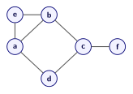
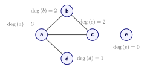

# Неориентированные графы

## Простой граф

Графы задаются указанием двух множеств: множества вершин  и множества рёбер, соединяющих эти вершины. 
Ребро в графе задаётся парой вершин. Сформулируем определение неориентированного графа:

**_Неориентированный граф_** --- это пара множеств:
- непустое множество $V$, элементы которого называются _вершинами_;
- множество неупорядоченных пар $(u,v)$, где $u,v$ различные (т.е. $u\neq v$) вершины из $V$, которые называются _рёбрами_.

В неупорядоченных парах порядок перечисления элементов не важен, т.е. $(u,v)$ и $(v,u)$ задают одно и тоже ребро. В список рёбер неориентированного графа включают только одну из пар $(u,v)$ или $(v,u)$.

Для обозначения графа обычно используют запись $G=(V,E)$, где под $V$  понимают множество вершин графа, а под $E$ - множество рёбер графа.

<figure class="figure figure--small" id="fig-graph">
  
  <figcaption>Граф с множеством вершин  $V = \{a, b, c, d, e, f\}$ и 
  множеством рёбер $E = \{(a,b), (a, d), (a,e), (b, c), (b,e), (c, d), (c, f)\}$.
</figcaption>
</figure>

Замечание

- Ребро, соединяющее вершину саму с собой $(u,u)$, называется _пятля_. Рёбра-петли появляются, например, при описании (моделировании) графа интернета, где веб-страница может содержать ссылку на себе. 
- Неориентированный граф без петель, где каждая пара вершин соединена не более, чем один ребром, называют также _простым_ графом.

## Cтепень вершины 

Вершины $v, w$ называются _**смежными**_, если в графе есть соединящее их ребро, т.е. $(v,w) \in E(G)$.

Смежные вершины часто называют _соседями_.  Соседей вершины  обозначают $N(v)$. 

Если вершина является концом некоторого ребра, то говорят, что вершина и ребро _инцидентны_ друг другу.

_**Степенью**_ вершины называется число её соседей, т.е. число инцидентных ей рёбер.

Для графа на [рисунке](#fig-graph) :
- вершины $a$ и $d$ смежны;
- ребро $(a,d)$ инцидентно вершинам $a$ и $d$;
- степень вершины $a$ равна $\deg(a) = 3$,  степень вершины $\deg(d) = 2$.

- Если степень вершины  $\deg(v)=0$, говорят, что $v$ --- _изолированная_ вершина.
- Если $\deg(v)=1$, говорят, что $v$ --- _висячая_ вершина или _лист_.

Попробуйте создать свой   граф в  [интерактивном редакторе](unit_01_graph_editor.md), посчитать степени вершин и найти множество соседей для произвольной вершины.

Задача

 
Сколько рёбер может быть в простом графе на $4$ вершинах?

- В графе может не быть рёбер, т.е. каждая вершина графа - это изолированная вершина, и $|E| = 0$;
- В простом графе каждая пара вершин может быть соединена ребром. Тогда в графе $|E| = 6$ рёбер: $(a,b), (a,c), (a,d), (b,c), (b,d)$ и $(c,d)$.
- В графе на $4$-х вершинах может быть не более $6$ рёбер.

## Сумма степеней вершин 

Лемма

 В неориентированном графе сумма степеней всех вершин  равна удвоенному числу его рёбер:
   $$\sum_{v\in V} \deg(v)=2 \cdot   |E|. $$

   

Доказательство

- Возьмем пустой граф. Сумма степеней вершин такого графа равна нулю. 
- При добавлении ребра, связывающего любые две вершины, сумма всех степеней увеличивается на 2 единицы. 
- Таким образом, сумма всех степеней вершин чётна и равна удвоенному числу рёбер.

Например, для следующего графа выполнено: $\deg(a) + \deg(b) + \deg(c) +\deg(d) + \deg(e) = 8 = 2\cdot |E|$.
 

<figure class="figure figure--small">
    
    <figcaption data-figure-number="2">
        Степени вершин графа
    </figcaption>
</figure>

Замечание

Сумма степеней вершин графа всегда чётное число.

Решим [задачу](#max-edges) в общем виде:

Задача

 
Сколько рёбер может быть в простом графе на $n$ вершинах?

- В графе может не быть рёбер, т.е. каждая вершина графа - это изолированная вершина, и $|E| = 0$;
- В простом графе каждая пара вершин может быть соединена ребром. 
- Тогда степень каждой вершины $\deg(v) = n - 1$. 
- По [утверждению](#sum-graph-degrees) $|E| = \frac{1}{2} \sum_{v\in V} \deg(v) = \frac{n(n-1)}{2}$.
- В простом графе может быть не более $|E|_{\max} = \frac{n(n-1)}{2}$ рёбер. 
- Для $n = 4$ максимально возможное число рёбер в простом графе равно $|E|_{\max} =\frac{4\cdot 3}{2} = 6$;
- Для графа на $n = 10$ вершинах число рёбер не может быть больше  $|E|_{\max} =\frac{10\cdot 9}{2} = 45$.

## Лемма о рукопожатиях

Рассмотрим задачу
Следующее утверждение носит название _лемма о рукопожатиях_.  Это название связано с задачей о рукопожатиях.

Задача

 
Перед началом конференции некоторые её участники пожали руки друг другу. Докажите,
что количество участников, сделавших _нечётное_ число рукопожатий, _чётно_.
(Рукопожатие симметрично, т.е. учитывается для обоих участников)

Лемма о рукопожатиях

Число вершин нечётной степени в любом графе чётно.

 
