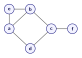

# Неориентированные графы

Графы задаются указанием двух множеств: множества вершин  и множества рёбер, соединяющих эти вершины. 
Ребро в графе задаётся парой вершин. Сформулируем определение неориентированного графа:

**_Неориентированный граф_** --- это пара множеств:
- непустое множество $V$, элементы которого называются _вершинами_;
- множество неупорядоченных пар $(u,v)$[^1], где $u,v$ некоторые вершины из $V$, которые называются _рёбрами_.

Для обозначения графа обычно используют запись $G=(V,E)$, где под $V$  понимают множество вершин графа, а под $E$ - множество рёбер графа.

<figure class="graph-figure" id="fig-graph">
  
  <figcaption>Граф с множеством вершин  $V = \{a, b, c, d, e, f\}$ и множеством рёбер $E = \{(a,b), (a, d), (a,e), (b, c), (b,e), (c, d), (c, f)\}$.
</figcaption>
</figure>

## Cтепень вершины 

Вершины $v, w$ называются _**смежными**_, если в графе есть соединящее их ребро, т.е. $(v,w) \in E(G)$.

Смежные вершины часто называют _соседями_.  Соседей вершины  обозначают $N(v)$. 

Если вершина является концом некоторого ребра, то говорят, что вершина и ребро _инцидентны_ друг другу.

_**Степенью**_ вершины называется число её соседей, т.е. число инцидентных ей рёбер.

Для графа на [рисунке](#fig-graph) :
- вершины $a$ и $d$ смежны;
- ребро $(a,d)$ инцидентно вершинам $a$ и $d$;
- степень вершины $a$ равна $\deg(a) = 3$,  степень вершины $\deg(d) = 2$.

- Если степень вершины  $\deg(v)=0$, говорят, что $v$ --- _изолированная_ вершина.
- Если $\deg(v)=1$, говорят, что $v$ --- _висячая_ вершина или _лист_.

Попробуйте создать свой   граф в  [интерактивном редакторе](unit_01_graph_editor.md), посчитать степени вершин и найти множество соседей для произвольной вершины.

[^1]: В неупорядоченных парах порядок перечисления элементов не важен, т.е. $(a,b)$ и $(b,a)$ задают однjои тоже ребро.