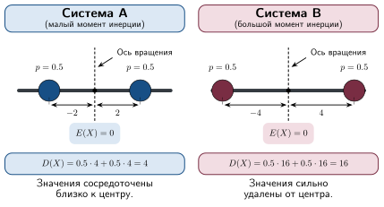

## Физический смысл дисперсии

В механике момент инерции характеризует распределение массы твердого тела (или системы тел) относительно оси вращения. Если масса тела определяет динамику поступательного двежиния, то момент инерции определеяет динамику вращательного движения.

По определению момент инерции относительно оси для материальной точки равен 
${I_z = mr^2,}$ где $m$ - масса точки, $r$ - расстояние от этой точки до оси вращения.

Дисперсия характеризует распределение (разброс) значений случайной величины вокруг её математического ожидания.

<figure class="figure figure--small" id="fig-variation">

<figcaption>
Физический смысл дисперсии
</figcaption>
</figure>

Замечание

Величина дисперсии определяется *не только* значениями, которые может принимать случайная величина, но и их *вероятностями*.

Рассмотрим пример на [рисунке ниже](#fig-variation-2).
Случайные величины $X$ и $Y$ принимают одинаковые значения и имеют одно и то же математическое ожидание, т.е. значения обеих величин одинаково рассеяны вокруг своих математических ожиданий. Однако, дисперсии этих величин различны, причем $DX > DY$. 

Если посмотреть на законы распределения этих величин, то такой результат можно предвидеть.
Вероятность "далеких" (с наибольшим отклонением) от мат. ожидания значений $X$ выше, чем вероятность этих же значений $Y$: $P(X = 3) > P(Y = 3)$. И наоборот, "близкие" к мат. ожиданию значения $X$ принимает с меньшей вероятностью, что $Y$:
${P(X = 1)< P(Y = 1)}$.

<figure class="figure figure--small" id="fig-variation-2">

<figcaption>
Дисперсия определяется не только значениями случайной величины, но и их вероятностями.
</figcaption>
</figure>