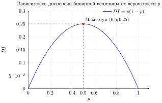

## Бинарная случайная величина

 [Бинарная случайная величина](../unit_05/unit_05_03_indicator.md) принимает только значения $0$ или $1$, и её математическое ожидание равно [$EI = p$](../unit_06/unit_06_01_expectation.md#математическое-ожидание-бинарной-случайной-величины).

***Дисперсия бинарной случайной величины*** $I$, имеющей распределение Бернулли 

$I \sim \begin{pmatrix} 0 & 1 \\ q & p \end{pmatrix}$, где $ p \in (0,1), \, q = 1 - p$, равна $$ DI = EI^2 - (EI)^2 = EI - (EI)^2 = p - p^2=p\cdot q.$$

Пример

Монетку бросают один раз. Найдите дисперсию случайной величины $I$ - "число выпавших орлов", если 
- монетка cимметричная;
- вероятность выпадения орла равна $p = 0.3$.

Посмотреть решение

- Для симметричной монетки $p = 0.5$, значит, $DI = 0.5\cdot 0.5 = 0.25$;
- Для несимметричной монетки с $p = 0.3$ дисперсия равна 
  
  $DI = 0.3 \cdot (1- 0.3) = 0.21$.

 

Рассмотрим дисперсию бинарной случайной величины как квадратичную функцию от $p$ на отрезке $[0; 1]$:  
$$DI = pq = p(1 - p) = p - p^2.$$ Функция  $DI(p)$ принимает наибольшее значение при $p = 0.5$: $D(0.5) = 0.25$.

<figure class="figure figure--small" id="fig-variation-2">

<figcaption>
Зависимость дисперсии бинарной случайной величины от вероятности $p$.
</figcaption>
</figure>

Утверждение

Дисперсия бинарной случайной величины имеет наибольшее значение $0.25$, которое достигается при $p = 0.5$.

   

