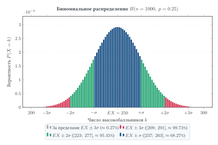
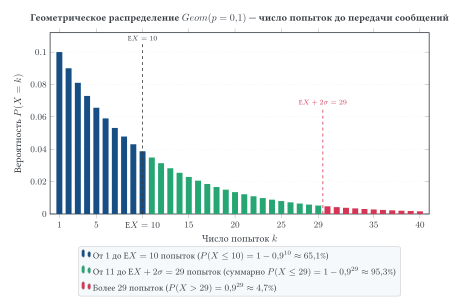

## Дисперсия биномиального распределения

Пусть производится $n$ независимых испытаний, в каждом из которых вероятность удачного исхода постоянна и равна $p$. Чему равна дисперсия числа успехов в этой серии испытаниях?

Пусть случайная величина $X$ имеет биномиальное распределение с параметрами $n$ и $p$:  
$$X \sim \begin{pmatrix} 0 & 1 & 2 & \dots & k & \dots & n \\ q^n & C_n^1 pq^{n-1} & C_n^2 p^2 q^{n-2} & \dots & C_n^k p^k q^{n-k} & \dots & p^n \end{pmatrix}.$$

Тогда $DX = npq$ и $\sigma = \sqrt{DX} = \sqrt{npq}$, где $q = 1 - p$.

- Пусть $X$ --- число успехов в серии из $n$ испытаний. 
  
- Представим $X = X_1 + \ldots +X_n$ (сумма индикаторов $X_i$)
- $X_i = \begin{cases} 1, \text{с вероятностью } p, \\ 0, \text{с вероятностью } q\end{cases}$. 
- $X_i$ - независимые случайные величины.
- Тогда $DX_1 = EX_1^2 - (EX_1)^2 = EX_1 - (EX_1)^2 = p -p^2 = p\cdot (1-q) = pq$ 
- $DX = DX_1 + \ldots +DX_n = n p q$.

Пример

В 2026 году $25\%$ школьников, сдаваших ЕГЭ по профильной математике набрали больше $80$ баллов. В 2027 в  $1000$ одинадцатиклассников из  школ Василеостровского района будут сдавать профильную математику. Считая, что уровень ЕГЭ и подготовки школьникво не изменился, оцените долю одинадцатиклассников, которые наберут более $80$ баллов в 2027 году.

Посмотреть решение

- $X$ количество выпускников, набравших $80+$ баллов.
- $p = 0.25$ - вероятность набрать более $80$ баллов на ЕГЭ. 
- $EX = np = 250$ - мат. ожидание числа "высокобалльников".
- Вычислим стандартное отклонение $\sigma = \sqrt{DX} = \sqrt{1000 \cdot 0.25 \cdot 0.75} = \sqrt{187.5} \approx 13.7$.
- Обратите внимание, что вне диапозона $[EX-3\sigma; EX+3\sigma]$ лежит менее $0.27\%$ возможных значений случайной величины.
- Суммарная вероятность значений от $223$ до $277$ примерно равна $0.9545$.

<figure class="figure figure--small" id="fig-variation-2">

<figcaption>
Диаграмма биномиального распределения.
</figcaption>
</figure>

## Дисперсия геометрического распределения

 Пусть случайная величина $X$ имеет геометрическое распределение с параметром $p$:  
$$X \sim \begin{pmatrix} 1 & 2 & 3 & 4 & \dots & k & \dots \\ p & qp & q^2p & q^3p & \dots & q^{k-1}p & \dots \end{pmatrix},$$
где $q = 1 - p$. 

Дисперсия и стандартное отклонение величины $X$ равны соответственно  
$DX = \cfrac{q}{p^2}$  и  $\sigma = \sqrt{DX} = \cfrac{\sqrt{q}}{p}.$

Пример

В условиях слабой мобильной связи абонент пытается отправить сообщение в мессенджере. Предположим, что вероятность успешной передачи при каждой попытке равна $p = 0.1$. Оцените количество попыток, которые потребуются для передачи сообщения.

Посмотреть решение

- В среднем в этих условиях потребуется $\frac{1}{p} = 10$ попыток.
- Вычислим $\sigma = \sqrt{DX} = \cfrac{\sqrt{0.9}}{0.1} \approx 9.5$.
- Суммарная вероятность значений от $1$ до $19$ - около 0.865; от $1$ до $29$ - $0.953$.

<figure class="figure figure--small" id="fig-variation-2">

<figcaption>
Диаграмма геометрического распределения.
</figcaption>
</figure>

