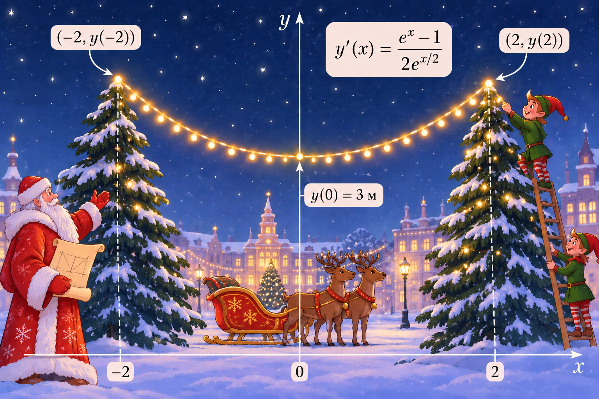

День второй. Украшаем ёлку

Готовя главную площадь к празднику, Дед Мороз поручил эльфам повесить светящуюся гирлянду между верхушками двух вековых елей, расстояние между которыми $4$ м (по горизонтали). Чтобы под гирляндой свободно проезжали сани с оленями, нижняя точка гирлянды, ровно посередине между елями, должна находиться на высоте $3$ метра над землёй. 

Эльфы внимательно изучили руководство по установке гирлянд и выяснили, что наклон гирлянды в каждой её точке описывается дифференциальным уравнением

$$ y'(x) = \cfrac{e^x - 1}{2 e^{x/2}}. $$

На полях руководства кто-то  начал восстанавливать форму гирлянды по её наклону

 $$ y(x) = \int \cfrac{e^x - 1}{2 e^{x/2}} dx + C, \;\; y(0) = 3,$$

 но не закончил (видимо, поля в руководстве слишком узкие).

Помогите эльфам выяснить, на какой высоте надо закрепить концы гирлянды. 

<figure class="figure figure--small" id="fig-advent_day_02">

<figcaption>
Расчёт новогодней гирлянды
</figcaption>
</figure>

