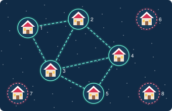

День третий. Доставка подарков

Дед Мороз планирует соединить $n$ городов волшебными двусторонними порталами. Каждая пара городов независимо
соединяется порталом с вероятностью $p$.

В города, не соединённые ни с одним другим городом, Деду Морозу придётся добираться на санях.

Найдите математическое ожидание числа городов, в которые Деду Морозу придётся отправиться на санях.

<figure class="figure figure--small" id="fig-advent_day_03">

<figcaption>
Граф доставки подарков
</figcaption>
</figure>

Проверить граф доставки

<iframe
    src="isolated_vertices_structured.html"
    title="Изолированные вершины случайного графа"
    width="100%"
    height="1000"
    style="border: 1px solid #a5acb4;
           border-radius: 12px;
           background: white;"
    loading="lazy">
</iframe>

