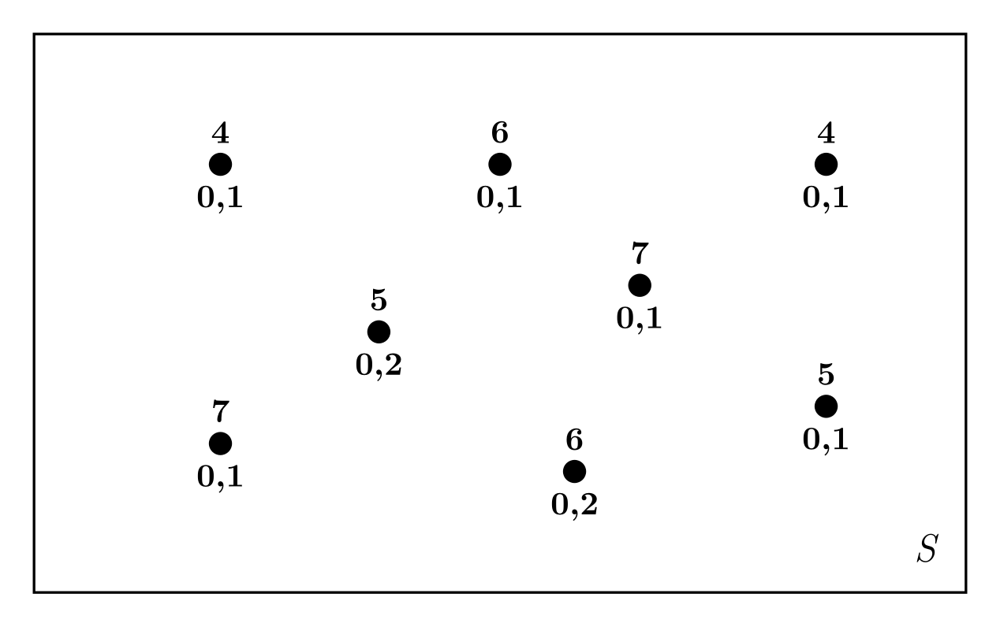
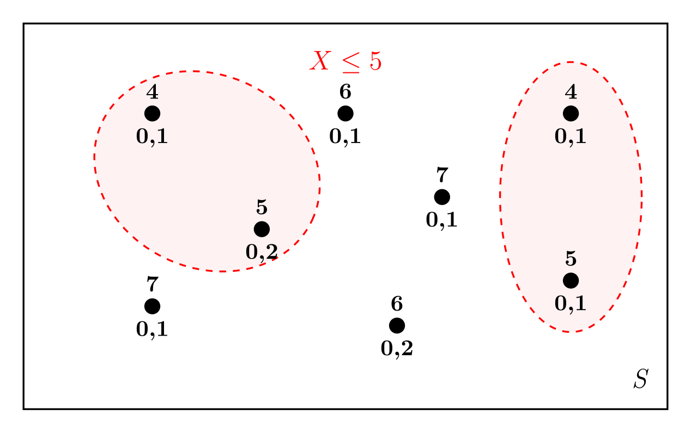
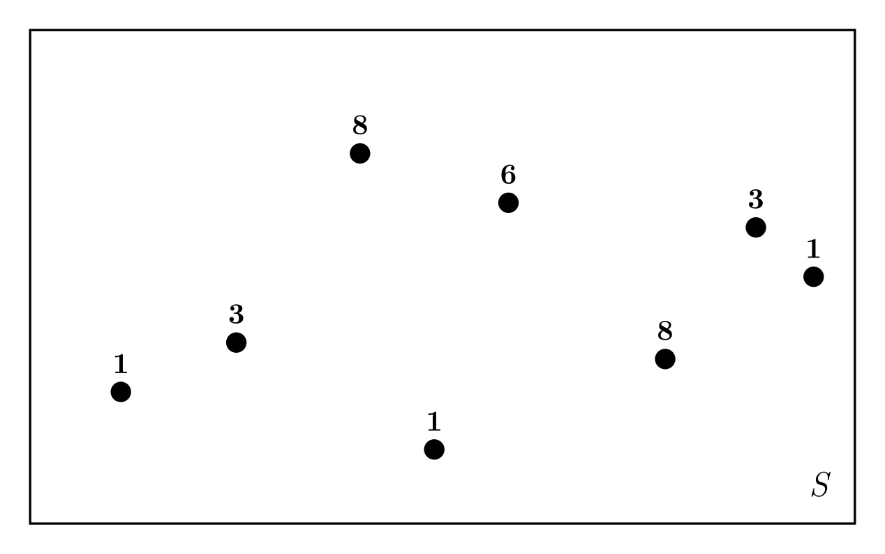
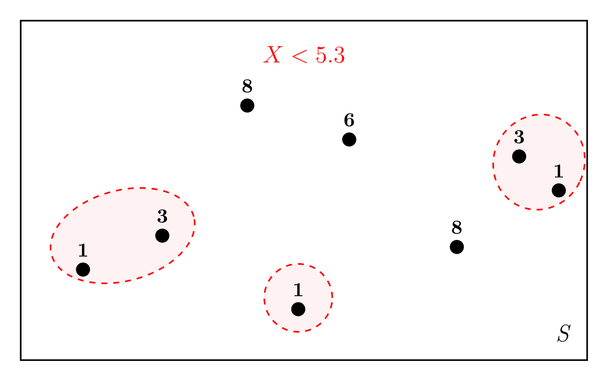

# Задача 5 (ЕГЭ -- 2027)

## Биномиальная схема: отношение вероятностей двух значений числа успехов

*Краткое описание прототипа*. Задача на схему испытаний Бернулли. Лайфхак: знать [формулу](../unit_05/unit_05_05_distributions.md#definition-binom-distr) вероятности $k$ успехов в серии из $n$ испытаний.

В магазине куплено $13$ одинаковых луковиц гиацинтов. Вероятность того, что каждая отдельная луковица успешно прорастёт, равна $0.8$. Во сколько раз вероятность события «прорастёт ровно $8$ луковиц» больше вероятности события «прорастёт ровно $5$ луковиц»?

Решение

- Схема испытаний Бернулли с вероятностью успеха $p = 0.8$ (вероятность того, что каждая отдельная луковица проросла);
  
- Всего в серии $n = 13$ испытаний по числу купленных луковиц гиацинтов;
- Событие $A =$«прорастёт ровно $8$ луковиц»: $8$ из $13$ испытаний были успешными:  $P(A) = C_{13}^8 \cdot p^{8} \cdot(1-p)^{5}$;
- Событие $B =$«прорастёт ровно $5$ луковиц»: $5$ из $13$ испытаний были успешными:  $P(B) = C_{13}^5 \cdot p^{5} \cdot(1-p)^{8}$;
- Найдем отношение $P(A)/P(B)$:
  $$ \frac{P(A)}{P(B)} = \frac{C_{13}^8 \cdot p^{8} \cdot (1-p)^{5}}{C_{13}^5 \cdot p^{5} \cdot (1-p)^{8}} =  \frac{p^{3}}{(1-p)^{3}}  = \frac{0.8^3}{0.2^3} = 4^3 = 2^6 = 64.$$
- Мы использовали свойство биномиальных коэффициентов $C_{13}^8 = C_{13}^{13-8} = C_{13}^5$.

## Случайное блуждание

*Краткое описание прототипа*. 

**Вариант 6.**

Первый член бесконечной последовательности целых чисел равен $0$. Каждый следующий член последовательности с вероятностью $p=0.8$ на единицу больше предыдущего и с вероятностью $1-p$ на единицу меньше предыдущего. Какова вероятность того, что среди членов этой последовательности найдётся число $-1$?

## Диаграмма Эйлера

*Краткое описание прототипа*. Задача перекликается с  [одним из вариантов задачи $6$](./unit_ege_06.md#task-type-2) --- определить вероятность события по заданному распределению дискретной случайной величины. Единственное отличие --- распределение случайной величины надо найти по картинке  (методом зоркого глаза 👁️ или любым другим доступным способом).

На диаграмме Эйлера схематически показан случайный опыт $S$, с которым связана случайная величина $X$. Около каждого элементарного события указана вероятность этого события и соответствующее значение случайной величины $X$. Найдите вероятность события $(X\leqslant 5)$.

<figure class="figure figure--small" id="fig-task-5-11">

</figure>

Решение

- Пристально рассмотрев картику, названную диаграммой Эйлера, заметим, что событию $X\leqslant 5$ соответствуют $4$ элементарных исхода (см. рисунок ниже).
- Осталось сложить вероятности $P(X\leqslant 5) = 0.1+0.5+0.1+0.1 = 0.5$.
<figure class="figure figure--small" id="fig-task-5-11">

</figure>

На диаграмме Эйлера схематически показан случайный опыт $S$, с которым связана случайная величина $X$. Все элементарные события равновозможны, и около каждого указано соответствующее значение случайной величины $X$. Найдите вероятность события $(X\leq5.3)$.

<figure class="figure figure--small" id="fig-task-5-11">

</figure>

Решение

- Снова внимательно посмотрев на картинку, заметим, что всего элементарных событий $8$ (по числу точек на рисунке);
- Cобытию $X < 5.3$ соответствуют $5$ элементарных исхода (см. рисунок ниже).
- Осталось найти вероятность $P(X < 5) = \frac{5}{8} = 0.625$.
  
<figure class="figure figure--small" id="fig-task-5-11">

</figure>

## Формула Байеса

*Краткое описание прототипа*. Задача на нахождение вероятности события при условии, что произошло другое событие. Формула Байеса:
$$ P(A|B) = \frac{P(B|A)\cdot P(A)}{P(B)}. $$

Первый игральный кубик обычный, а на гранях второго кубика числа $2$, $4$ и $6$ встречаются по два раза. В остальном кубики одинаковые. Один случайно выбранный кубик бросают два раза. Известно, что в каком-то порядке выпали $2$ и $4$ очка. Какова вероятность того, что бросали второй кубик?

Решение

- Нам надо найти вероятность того, что бросали второй кубик (событие $A$) при условии, что выпало $2$ и $4$ очка в некотором порядке (событие $B$).
- Вероятноcть того, что бросали второй кубик равна $P(A) = 1/2$;
- Вероятность того, что на втором кубике выпала $2$ очка равна $1/3$ (из $6$ чисел на кубике $2$ встречается два раза);
- Аналогично, вероятность того, что на втором кубике выпала $4$ очка равна $1/3$;
- Порядок выпадения очков неизвесен,  поэтому $P(B|A) = 2 \cdot \frac{1}{3}\cdot \frac{1}{3} = \frac{2}{9}$.
- Найдем теперь полную вероятность события $B$:
  $$ P(B) = \frac{1}{2}\cdot 2\cdot \frac{1}{36}\cdot\frac{1}{36} + \frac{1}{2}\cdot 2\cdot \frac{1}{9}\cdot\frac{1}{9} = \frac{5}{36}. $$
- Подставляем все в формулу Байеса:
  $$ P(A|B) = \frac{P(B|A)\cdot P(A)}{P(B)} = \frac{\frac{2}{9}\cdot \frac{1}{2}}{\frac{5}{36}} = \frac{4}{5} = 0.2. $$

## Формула полной вероятности

**Вариант 36.**

Агрофирма закупает куриные яйца в двух домашних хозяйствах. $15\%$ яиц из первого хозяйства — яйца высшей категории, а из второго хозяйства — $65\%$ яиц высшей категории. Всего высшую категорию получает $45\%$ яиц. Найдите вероятность того, что яйцо, купленное у этой агрофирмы, окажется из первого хозяйства.

Решение

- Пусть $p$ --- вероятность того, что случайно выбранное яйцо поступило из первого хозяйства.
- Тогда вероятность, что выбранное яйцо из второго хозяйства равна $1-p$.
- $0.15\cdot p$ --- доля яиц высшей категории из первого хозяйства;
- $0.65 \cdot (1-p)$ --- доля яиц высшей категории из  второго хозяйства;
- Воспользуемся формулой полной вероятности для события «яйцо имеет высшую категорию»:
$$ 0.15\cdot p + 0.65 \cdot (1-p) = 0.45.$$
- Решая уравнение, получаем $p = 0.4$.

## Повторные независимые испытания: минимальное число выстрелов

**Вариант 26.**

Стрелок в тире стреляет по мишени до тех пор, пока не поразит её. Известно, что при каждом отдельном выстреле вероятность промаха равна $0.8$. Сколько патронов нужно дать стрелку, чтобы он поразил цель с вероятностью не менее $0.62$?

Решение

- Пусть у стрелка есть $k$ патронов.
- Вероятность, что стрелок $k$ промахнется равна $P(k \text{ промахов}) = 0.8^{k}$;
- Вероятность того, что цель будет поражена за не более, чем $k$ попыток равна:
$p = 1- P(k \text{ промахов}) = 1 - 0.8^{k} \geqslant 0.62$.
- Осталось решить неравенство:
$$ 1 - 0.8^{k} \geqslant 0.62 \ \Rightarrow \ 0.8^k \leqslant 0.38 $$

- $0.8^3 = 0.512 > 0.38$;
- $0.8^4 = 0.4096 > 0.38$;
- $0.8^5 = 0.32768 < 0.38$.
- Ответ: $5$ патронов.

## Математическое ожидание по закону распределения

*Краткое описание прототипа*. Задача полностью совпадает с   [одним из вариантов задачи $6$](./unit_ege_06.md#task-type-4).

В таблице показано распределение случайной величины $X$. Найдите $EX$ — математическое ожидание этой случайной величины.

| Значения $X$ | $-4$ | $0$ | $1$ | $3$ |
| --- | ---: | ---: | ---: | ---: |
| Вероятности | $0.2$ | $0.1$ | $0.4$ | $0.3$ |

Решение

- Распределение случайной задано, сразу вычисляем  математическое ожидание:

$$ EX = (-4)\cdot 0.1 + 0\cdot 0.1 + 1 \cdot 0.4 + 3 \cdot 0.3 = 0.5  $$

