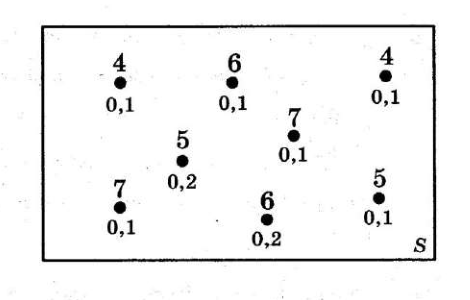
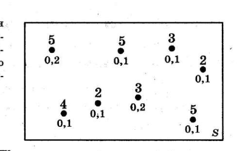
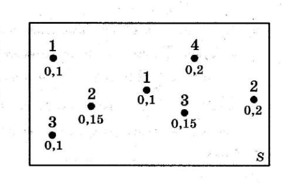
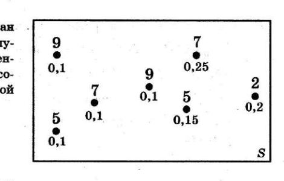
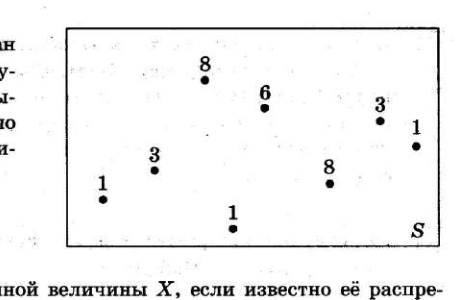
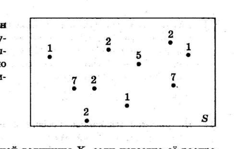
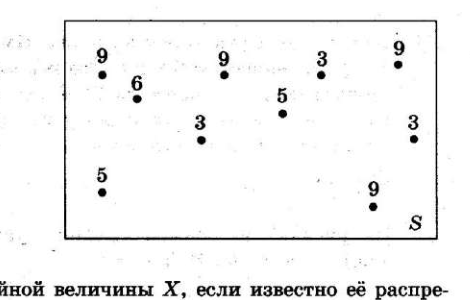
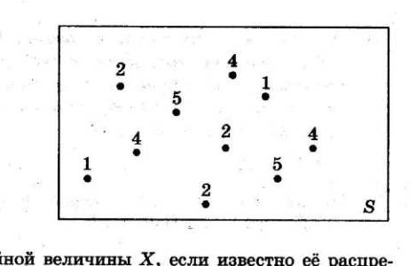
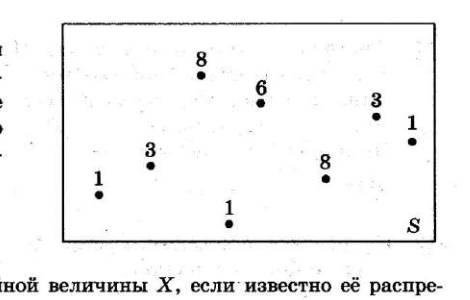

# Задания №5 из всех 37 вариантов

В разделе собраны задачи $5$ из первой части вариантов из [сборника типовых вариантов экзаменационных заданий](https://www.chitai-gorod.ru/product/ege-2027-37-tvez-matematika-profil-nyj-uroven-37-variantov-tipovye-varianty-ekzamenacionnyh-zadanij-3180822).

В магазине куплено $13$ одинаковых луковиц гиацинтов. Вероятность того, что каждая отдельная луковица успешно прорастёт, равна $0.8$. Во сколько раз вероятность события «прорастёт ровно $8$ луковиц» больше вероятности события «прорастёт ровно $5$ луковиц»?

В магазине куплено $18$ одинаковых луковиц гиацинтов. Вероятность того, что каждая отдельная луковица успешно прорастёт, равна $0.6$. Во сколько раз вероятность события «прорастёт ровно $10$ луковиц» больше вероятности события «прорастёт ровно $8$ луковиц»?

Баскетболист на тренировке бросает мяч в кольцо $9$ раз. Вероятность попадания при каждой отдельной попытке равна $0.6$. Во сколько раз вероятность события «ровно $4$ попадания» больше вероятности события «ровно $2$ попадания»?

При мелкосерийном изготовлении деталей на фрезерном станке вероятность того, что деталь окажется бракованной, равна $0.05$ независимо от других деталей. Всего в партии $14$ деталей. Во сколько раз вероятность события «ровно две детали из партии бракованные» больше вероятности события «ровно три детали из партии бракованные»?

В партии банок солёных огурцов каждая отдельная банка может оказаться негерметично закрытой с вероятностью $0.04$. Всего в партии $18$ банок. Во сколько раз вероятность события «все банки в партии герметичны» больше вероятности события «ровно две банки негерметично закрыты»? Результат округлите до сотых.

Первый член бесконечной последовательности целых чисел равен $0$. Каждый следующий член последовательности с вероятностью $p=0.8$ на единицу больше предыдущего и с вероятностью $1-p$ на единицу меньше предыдущего. Какова вероятность того, что среди членов этой последовательности найдётся число $-1$?

Первый член бесконечной последовательности целых чисел равен $0$. Каждый следующий член последовательности с вероятностью $p=\frac{10}{13}$ на единицу больше предыдущего и с вероятностью $1-p$ на единицу меньше предыдущего. Какова вероятность того, что среди членов этой последовательности найдётся число $-1$?

Первый член бесконечной последовательности целых чисел равен $0$. Каждый следующий член последовательности с вероятностью $p=\frac{5}{7}$ на единицу больше предыдущего и с вероятностью $1-p$ на единицу меньше предыдущего. Какова вероятность того, что среди членов этой последовательности найдётся число $-1$?

Первый член бесконечной последовательности целых чисел равен $0$. Каждый следующий член последовательности с вероятностью $p=\frac{20}{31}$ на единицу больше предыдущего и с вероятностью $1-p$ на единицу меньше предыдущего. Какова вероятность того, что среди членов этой последовательности найдётся число $-1$?

Первый член бесконечной последовательности целых чисел равен $0$. Каждый следующий член последовательности с вероятностью $p=\frac{20}{33}$ на единицу больше предыдущего и с вероятностью $1-p$ на единицу меньше предыдущего. Какова вероятность того, что среди членов этой последовательности найдётся число $-1$?

На диаграмме Эйлера схематически показан случайный опыт $S$, с которым связана случайная величина $X$. Около каждого элементарного события указана вероятность этого события и соответствующее значение случайной величины $X$. Найдите вероятность события $(X\leq5)$.

На диаграмме Эйлера схематически показан случайный опыт $S$, с которым связана случайная величина $X$. Около каждого элементарного события указана вероятность этого события и соответствующее значение случайной величины $X$. Найдите вероятность события $(X=7)$.

На диаграмме Эйлера схематически показан случайный опыт $S$, с которым связана случайная величина $X$. Около каждого элементарного события указана вероятность этого события и соответствующее значение случайной величины $X$. Найдите вероятность события $(2<X\leq5)$.

На диаграмме Эйлера схематически показан случайный опыт $S$, с которым связана случайная величина $X$. Около каждого элементарного события указана вероятность этого события и соответствующее значение случайной величины $X$. Найдите вероятность события $(X\leq2)$.

На диаграмме Эйлера схематически показан случайный опыт $S$, с которым связана случайная величина $X$. Около каждого элементарного события указана вероятность этого события и соответствующее значение случайной величины $X$. Найдите вероятность события $(X>1)$.

На диаграмме Эйлера схематически показан случайный опыт $S$, с которым связана случайная величина $X$. Все элементарные события равновозможны, и около каждого указано соответствующее значение случайной величины $X$. Найдите вероятность события $(X\leq5.3)$.

На диаграмме Эйлера схематически показан случайный опыт $S$, с которым связана случайная величина $X$. Все элементарные события равновозможны, и около каждого указано соответствующее значение случайной величины $X$. Найдите вероятность события $(2\leq X<7)$.

На диаграмме Эйлера схематически показан случайный опыт $S$, с которым связана случайная величина $X$. Все элементарные события равновозможны, и около каждого указано соответствующее значение случайной величины $X$. Найдите вероятность события $(X>5.1)$.

На диаграмме Эйлера схематически показан случайный опыт $S$, с которым связана случайная величина $X$. Все элементарные события равновозможны, и около каждого указано соответствующее значение случайной величины $X$. Найдите вероятность события $(X\leq4.37)$.

На диаграмме Эйлера схематически показан случайный опыт $S$, с которым связана случайная величина $X$. Все элементарные события равновозможны, и около каждого указано соответствующее значение случайной величины $X$. Найдите вероятность события $(3<X<6)$.

Первый игральный кубик обычный, а на гранях второго кубика числа $2$, $4$ и $6$ встречаются по два раза. В остальном кубики одинаковые. Один случайно выбранный кубик бросают два раза. Известно, что в каком-то порядке выпали $2$ и $4$ очка. Какова вероятность того, что бросали второй кубик?

Первый игральный кубик обычный, а на гранях второго кубика числа $3$ и $4$ встречаются по три раза. В остальном кубики одинаковые. Один случайно выбранный кубик бросают два раза. Известно, что в каком-то порядке выпали $3$ и $4$ очка. Какова вероятность того, что бросали второй кубик?

Первый игральный кубик обычный, а на гранях второго кубика числа $2$, $4$ и $6$ встречаются по два раза. В остальном кубики одинаковые. Один случайно выбранный кубик бросают два раза. Известно, что в каком-то порядке выпали $2$ и $4$ очка. Какова вероятность того, что бросали первый кубик?

Первый игральный кубик обычный, а на гранях второго кубика числа $3$ и $4$ встречаются по три раза. В остальном кубики одинаковые. Один случайно выбранный кубик бросают два раза. Известно, что в каком-то порядке выпали $3$ и $4$ очка. Какова вероятность того, что бросали первый кубик?

Первый игральный кубик обычный, а на гранях второго кубика числа $1$, $2$ и $3$ встречаются по два раза. В остальном кубики одинаковые. Один случайно выбранный кубик бросают два раза. Известно, что в каком-то порядке выпали $2$ и $3$ очка. Какова вероятность того, что бросали первый кубик?

Стрелок в тире стреляет по мишени до тех пор, пока не поразит её. Известно, что при каждом отдельном выстреле вероятность промаха равна $0.8$. Сколько патронов нужно дать стрелку, чтобы он поразил цель с вероятностью не менее $0.62$?

Стрелок в тире стреляет по мишени до тех пор, пока не поразит её. Известно, что при каждом отдельном выстреле вероятность промаха равна $0.8$. Сколько патронов нужно дать стрелку, чтобы он поразил цель с вероятностью не менее $0.57$?

Стрелок в тире стреляет по мишени до тех пор, пока не поразит её. Известно, что при каждом отдельном выстреле вероятность промаха равна $0.7$. Сколько патронов нужно дать стрелку, чтобы он поразил цель с вероятностью не менее $0.6$?

Стрелок в тире стреляет по мишени до тех пор, пока не поразит её. Известно, что при каждом отдельном выстреле вероятность промаха равна $0.7$. Сколько патронов нужно дать стрелку, чтобы он поразил цель с вероятностью не менее $0.77$?

Стрелок в тире стреляет по мишени до тех пор, пока не поразит её. Известно, что при каждом отдельном выстреле вероятность промаха равна $0.6$. Сколько патронов нужно дать стрелку, чтобы он поразил цель с вероятностью не менее $0.87$?

В таблице показано распределение случайной величины $X$. Найдите $EX$ — математическое ожидание этой случайной величины.

| Значения $X$ | $-4$ | $0$ | $1$ | $3$ |
| --- | ---: | ---: | ---: | ---: |
| Вероятности | $0.2$ | $0.1$ | $0.4$ | $0.3$ |

В таблице показано распределение случайной величины $X$. Найдите $EX$ — математическое ожидание этой случайной величины.

| Значения $X$ | $-5$ | $1$ | $2$ | $3$ |
| --- | ---: | ---: | ---: | ---: |
| Вероятности | $0.3$ | $0.2$ | $0.3$ | $0.2$ |

В таблице показано распределение случайной величины $X$. Найдите $EX$ — математическое ожидание этой случайной величины.

| Значения $X$ | $-1$ | $2$ | $4$ | $6$ |
| --- | ---: | ---: | ---: | ---: |
| Вероятности | $0.6$ | $0.1$ | $0.2$ | $0.1$ |

В таблице показано распределение случайной величины $X$. Найдите $EX$ — математическое ожидание этой случайной величины.

| Значения $X$ | $-3$ | $0$ | $2$ | $3$ |
| --- | ---: | ---: | ---: | ---: |
| Вероятности | $0.6$ | $0.1$ | $0.2$ | $0.1$ |

В таблице показано распределение случайной величины $X$. Найдите $EX$ — математическое ожидание этой случайной величины.

| Значения $X$ | $-5$ | $-2$ | $0$ | $8$ |
| --- | ---: | ---: | ---: | ---: |
| Вероятности | $0.1$ | $0.3$ | $0.2$ | $0.4$ |

Агрофирма закупает куриные яйца в двух домашних хозяйствах. $15\%$ яиц из первого хозяйства — яйца высшей категории, а из второго хозяйства — $65\%$ яиц высшей категории. Всего высшую категорию получает $45\%$ яиц. Найдите вероятность того, что яйцо, купленное у этой агрофирмы, окажется из первого хозяйства.

Агрофирма закупает куриные яйца в двух домашних хозяйствах. $75\%$ яиц из первого хозяйства — яйца высшей категории, а из второго хозяйства — $25\%$ яиц высшей категории. Всего высшую категорию получает $70\%$ яиц. Найдите вероятность того, что яйцо, купленное у этой агрофирмы, окажется из первого хозяйства.

